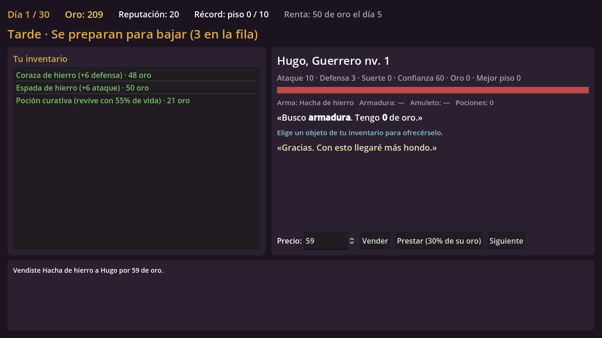

# Tienda del Último Piso

Juego 2D de gestión: llevas la tienda en la cima de una mazmorra. Compras barato el botín de los aventureros que suben heridos, decides a quién armar antes de que vuelvan a bajar y pagas la renta al Gremio. Ganas cuando alguien derrota al Señor de la Mazmorra en el piso 10.

Diseño completo: [docs/DISENO.md](docs/DISENO.md).

## Cómo jugar el prototipo
1. Instala [Godot 4.3](https://godotengine.org/download) (o más nuevo).
2. En Godot, "Importar" y elige `tienda-ultimo-piso/project.godot`.
3. Pulsa F5.

Cada día:
- **Mañana**: los que volvieron te ofrecen su botín. Escribe tu oferta y regatea; cuanto más heridos, más baratos. Si te pasas, se van.
- **Tarde**: cada aventurero busca algo. Elige un objeto de tu inventario y **Vende** a tu precio o **Presta** (vuelve el objeto y el 30% de su oro si sobrevive).
- **Noche**: abre la puerta y lee el informe.

## Estructura
- `scripts/game.gd`: reglas del día, economía, renta, victoria y derrota.
- `scripts/dungeon.gd`: simulación de la expedición piso a piso.
- `scripts/adventurer.gd`, `scripts/item.gd`: datos de aventureros y objetos.
- `scripts/main.gd`: interfaz (construida por código, sin arte todavía).

## Pruebas
- Balance con 300 partidas de un bot simple:
  `godot --headless --path . --script res://tests/sim.gd`
- Capturas (necesita pantalla, por ejemplo `xvfb-run`):
  `godot --path . --script res://tests/screenshot.gd -- <carpeta>`
